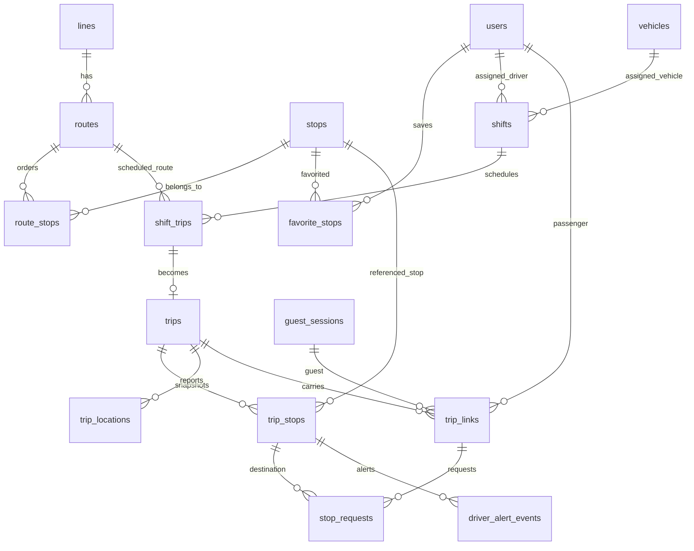

# VoyBus — Arquitectura y reglas del dominio (acuerdos v1.1; desarrollo paralelo)

## 1. Límites del trabajo

- **Gianny**: RED-01 (consulta líneas/recorridos), RED-02 (paraderos y favoritos), VIA-01 (vinculación QR/código), VIA-02 (solicitud), VIA-03 (seguimiento).
- **Martín**: visualización de vehículos (figura como un segundo `RED-02` en la ERS, ID definitivo pendiente), VEH-01 (viaje/GPS), VEH-02 (alertas), ADM-03 (turnos/asignaciones).
- **Propiedad asignada:** Gianny crea autenticación/sesiones, esquema y seed de catálogo; Martín agrega seed de vehículos/conductores/turnos según el catálogo existente. Ambos usan arquitectura, contratos API y pruebas compartidos. Un único esquema relacional y un único backend integrado.

## 2. Tecnología y convenciones

- Cliente: React Native con Expo; navegación `expo-router`, mapa `react-native-maps`, GPS `expo-location`, QR `expo-camera`, tokens en `expo-secure-store`. Las versiones específicas se instalarán con `npx expo install` y se alinearán al mismo SDK de Expo antes de integrar.
- Servidor: Node.js + Express; SQLite con claves foráneas activas para **cada conexión**.
- API: `http(s)://HOST:PORT/api/v1`; respuestas JSON `camelCase`, BD `snake_case`.
- Fechas de eventos: UTC ISO 8601 como `2026-11-15T18:00:00.000Z`; UI convierte a hora local. Horarios del turno se almacenan como instantes UTC; el horario local mostrado corresponde a `America/Santiago`.
- Coordenadas WGS84: latitud [-90,90], longitud [-180,180]. Metros para precisión/distancia. Horarios de recorridos locales como texto `HH:mm` y días como array JSON [1..7] (1=lunes, 7=domingo).
- Contratos estables, sin alterar los nombres de campos por conveniencia local. No duplicar entidades ni crear otra API para el mismo dominio.
- No afirmar tiempo real estricto cuando se use polling. Los vehículos y las solicitudes se actualizarán automáticamente, mostrando instante de última actualización y estado de datos atrasados.

## 3. Relaciones esenciales

`lines` 1:N `routes`; `routes` 1:N `route_stops`; `route_stops` N:1 `stops`.

`users(driver)` 1:N `shifts`; `vehicles` 1:N `shifts`; `shifts` 1:N `shift_trips`; `shift_trips` 1:0..1 `trips`; `trips` 1:N `trip_locations` y `trip_stops`.

`trip_stops` es una **instantánea** del recorrido al empezar un viaje. Evita que cambios posteriores en `route_stops` modifiquen un viaje activo.

`trips` 1:N `trip_links` (vinculación de pasajero registrado o invitado); `trip_links` 1:N `stop_requests`, con máximo **una solicitud pendiente** por vínculo; `stop_requests` referencia un `trip_stop` del mismo viaje.

`users(passenger)` N:M `stops` vía `favorite_stops`; los invitados no guardan favoritos.

`driver_alert_events` representa la primera alerta por paradero solicitado en un viaje; `driver_alert_deliveries` guarda qué conductor ya recibió el aviso sonoro/visual para impedir la repetición al reconectar.

### Esquema en Mermaid

Este diagrama es conceptual; el `schema.sql` es la fuente precisa de restricciones, columnas e índices.

## 4. Invariantes de negocio

1. **Público**: líneas, recorridos, paraderos y vehículos activos son consultables sin iniciar sesión.
2. **Favoritos**: exclusivamente para cuentas con rol `passenger` autenticadas; se conservan entre sesiones.
3. **Usuarios/roles**: pasajero, conductor, administrador; el invitado no es un usuario de rol privilegiado y se identifica con `guest_sessions`. Nunca usar `userId` remitido por el cliente como autorización.
4. **Una vinculación activa** por pasajero (registrado o invitado). `POST /trip-links` solo acepta un vehículo con viaje activo y no se basa en el QR como prueba de presencia física.
5. **Una solicitud pendiente por vínculo**; no se puede elegir un paradero con secuencia igual o inferior a `trips.last_passed_sequence`. `idempotencyKey` previene duplicados en reintentos de red.
6. **Estados de solicitudes**: `sent` (registrada); `next` (el destino es el siguiente paradero futuro); `closed` con `stop_passed` o `trip_finished`. No existe estado `attended` porque pasar cerca no demuestra que el pasajero haya descendido.
7. **Un viaje activo por conductor**; un vehículo tampoco puede participar en dos viajes activos. Al terminar el viaje, se cierran las solicitudes pendientes, se liberan los vínculos y no se muestran ubicaciones como vehículos en circulación.
8. **Turno diferente de viaje**: un turno puede tener varios viajes. Finalizar un viaje no termina automáticamente su turno.
9. **Turnos no superpuestos** para un mismo conductor o vehículo. Validar en transacción usando el criterio `[inicio, fin)`; no permitir asignar conductor deshabilitado o vehículo fuera de servicio/mantenimiento.
10. **Progreso del viaje**: `last_passed_sequence` aumenta de manera monótona y solo con evidencia razonable del avance por la ruta. Nunca avanzar por una lectura GPS aislada ni por simple cercanía lateral a una parada. Ante GPS ausente o poco confiable se conserva el valor anterior y se marca la actualización como atrasada.
11. **Alertas del conductor**: solicitudes para un mismo paradero se agrupan en un contador; solo la primera activa un nuevo evento sonoro. El backend conserva entregas para no repetir avisos antiguos al reconectar. No exige pulsar un botón de confirmación al conductor.
12. **No inventar confirmaciones de bajada**. Un aviso cerrado significa parada superada o viaje finalizado, no que el conductor efectivamente se detuvo.
13. **No filtrar información sensible**: datos de conductor/usuario privado, tokens y contraseñas no se devuelven en endpoints públicos ni logs.

## 5. Algoritmo a acordar para avance y paraderos

La ERS requiere actualización automática, pero no fija un algoritmo de map matching. Propuesta de implementación:
- Cada ruta lleva `geometry_json` con puntos ordenados y `trip_stops` en secuencia; los puntos deben representar un recorrido válido.
- Backend recibe muestras GPS del conductor con `sampledAt`, `accuracyMeters`, latitud y longitud.
- Validar edad, precisión y coherencia con la polilínea. Proyectar sobre la geometría y usar avance **monótono**, histéresis y varias muestras para evitar saltos por ruido GPS.
- Solo cuando exista avance confiable más allá de un paradero actualizar `last_passed_sequence`; aplicar transaccionalmente los cambios de solicitudes `sent`/`next`/`closed`.
- Si no se puede inferir razonablemente el progreso con datos reales, mantener las posiciones sin avanzar y registrar el problema. **No fabricar datos o estados en el video**.
- La elección exacta de umbrales, períodos, tolerancias y pruebas en dispositivos debe acordarse antes de programar VEH-01 y VIA-03.

## 6. Decisiones pendientes antes de comenzar

- **Identificador duplicado RED-02**: consultar si la visualización de vehículos debe pasar a RED-03.
- **Responsable de acceso mínimo: Gianny.** Aunque ACC-01/02 no están entre los nueve, se requieren credenciales demo de administrador/conductor y mecanismo de invitado; Martín consume los middleware y contratos, sin crear otra autenticación definitiva.
- **Mapa/navegación**: se utilizarán `expo-router`, `react-native-maps`, `expo-location`, `expo-camera` y `expo-secure-store`; registrar versiones compatibles con el SDK Expo elegido al iniciar el código y antes de integrar.
- **Progreso**: algoritmo, indicadores de GPS atrasado y casos de recorrido circular. El diseño de `route_stops` permite repetir un mismo paradero en secuencias diferentes.
- **Seeds**: como mínimo 3 líneas, 10 paraderos y 10 vehículos. Si los datos son ficticios, rotularlos como datos de demostración; no presentarlos como servicios reales de Antofagasta.
- **Desarrollo simultáneo sin scaffold previo:** cada integrante trabaja en su rama desde un commit mínimo compartido; módulos de Martín deben ser separables de sus arranques temporales y no sobrescribir configuración, auth ni entrypoints de Gianny. Consultar `INTEGRACION_PARALELA.md`.

## 7. Validaciones no implementadas solo con el esquema

Las condiciones siguientes exigen lógica transaccional del backend: autorizaciones de roles, solapamiento de turnos, coincidencia de asignación/ruta/vehículo al iniciar viaje, límite de un viaje activo por conductor/vehículo, detección confiable de paradero superado, expiración de sesión, unicidad de solicitudes con concurrencia, deduplicación de notificaciones y transición consistente de estado. **La existencia de tablas no satisface estas validaciones por sí sola.**

## 8. Integración desde ramas independientes (v1.1)

No se presupone que ambos tengan el mismo proyecto React Native/Express en sus ramas durante el desarrollo. Sus implementaciones **no deben sustituirse mutuamente** al integrar. Solo se trasladarán los módulos de dominio y sus pruebas a la aplicación/base backend final; los `package.json`, enrutadores raíz, servidor, auth, inicialización SQLite y `.env.example` se consolidarán una sola vez. Gianny mantiene los puntos de entrada y autenticación final; Martín documentará exactamente qué módulos exporta, rutas monta, pantallas integra y bibliotecas necesita.

Los contratos se consideran congelados para codificar; si un cambio es imprescindible se registra como propuesta y se aprueba por ambos antes de editar los archivos compartidos.
